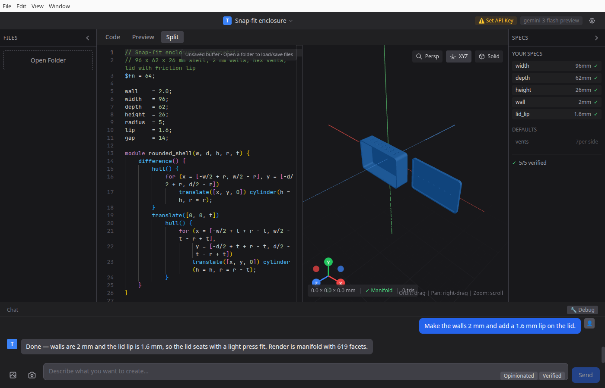
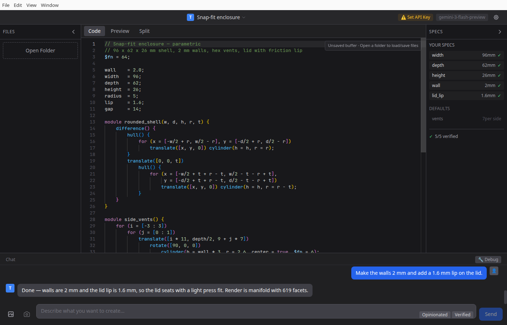

# TalkCAD

[](https://github.com/outerreaches/talkcad/actions/workflows/ci.yml)

**Describe a part in plain language. Get parametric OpenSCAD, a live 3D preview, and a printable STL.**

<p align="center">
  
</p>

TalkCAD is a desktop CAD tool built around an LLM agent that writes [OpenSCAD](https://openscad.org/)
for you, renders it, checks the result against the dimensions you asked for, and repairs its own
mistakes. The output is ordinary OpenSCAD — you can read it, edit it, and keep it forever.

## Features

- **Natural Language Interface** — Describe what you want to create in plain English
- **Live 3D Preview** — Real-time STL rendering with orbit controls, wireframe mode, and axis visualization
- **Multi-Agent Architecture** — Orchestrator, Builder, and Researcher agents work together
- **Automatic Verification** — Code and visual verification to ensure specs are met
- **Spec Tracking** — Explicit and inferred specifications with verification status
- **Knowledge Base** — Built-in skills library with design rules, techniques, and dimensions
- **Web Research** — Integrated web search for finding real-world dimensions and references
- **Image Support** — Attach reference images or capture viewport screenshots
- **Local or cloud models** — OpenRouter, OpenAI, Gemini, Groq, Ollama, LM Studio, llama.cpp, or any OpenAI-compatible endpoint

## How it works

1. You describe the part and any hard dimensions.
2. The agent retrieves relevant design rules from the bundled knowledge base, asks for anything it
   cannot infer, and writes OpenSCAD.
3. OpenSCAD renders the model; the agent verifies the geometry against your specifications —
   by reading the code, by inspecting render statistics, and optionally by looking at rendered views.
4. Failed checks go back to the agent as a repair task. The loop is bounded and every step is visible
   in the chat.


## Prerequisites

TalkCAD shells out to **OpenSCAD** for every render — it is not bundled, install it first:

| Platform | Install |
|----------|---------|
| macOS | `brew install --cask openscad`, or the .dmg from openscad.org |
| Windows | Installer from [openscad.org/downloads](https://openscad.org/downloads.html) |
| Linux | `sudo apt install openscad` · `sudo dnf install openscad` · snap |

If macOS blocks OpenSCAD on first launch, see [Troubleshooting](#troubleshooting).

#### Expected Installation Paths

TalkCAD auto-detects OpenSCAD at these locations:

| Platform | Paths |
|----------|-------|
| **macOS** | `/Applications/OpenSCAD.app/Contents/MacOS/OpenSCAD`, `/opt/homebrew/bin/openscad`, `/usr/local/bin/openscad` |
| **Windows** | `C:\Program Files\OpenSCAD\openscad.exe`, `C:\Program Files (x86)\OpenSCAD\openscad.exe` |
| **Linux** | `/usr/bin/openscad`, `/usr/local/bin/openscad`, `/snap/bin/openscad` |

If OpenSCAD is installed elsewhere, you can set the path manually in Settings.

## Getting Started

### Install a release

Linux packages (AppImage and `.deb`) are published on the
[Releases](https://github.com/outerreaches/talkcad/releases) page. They are unsigned; on first launch
your OS may ask you to confirm. macOS and Windows builds are produced from source with `pnpm build`
until signed releases exist.

### Build from source

```bash
pnpm install
cd apps/desktop
pnpm dev
```

Build a distributable app with `pnpm build` (runs `tsc`, `vite build` and `electron-builder`).

### API Key Setup

TalkCAD needs an LLM provider. OpenRouter is the default and the only provider that supports the
web-research tools.

1. Get a key at [openrouter.ai/keys](https://openrouter.ai/keys) — or start a local model in Ollama
   and pick that provider instead.
2. Open **Settings** (gear icon), paste the key, choose a model.

The key is encrypted with the OS keychain (macOS Keychain, Windows DPAPI, Linux libsecret) whenever
one is available; if there is no usable keyring, it is written to `config.json` with `0600`
permissions and the app warns at startup. The headless CLI never touches the encrypted copy — it
reads `OPENROUTER_API_KEY` / `LLM_PROVIDER` / `LLM_MODEL` from the environment.

### Storage locations

TalkCAD stores data in your OS user data directory (Electron `app.getPath('userData')`):

- **Sessions/projects**: `<userData>/projects` (override via `TALKCAD_PROJECTS_DIR`)
- **Config (shared with CLI)**: `<userData>/config.json`
- **User-created skills**: `<userData>/skills`

## Screenshots

| Code and chat | Split view with the rendered model |
|---|---|
|  |  |

## User Interface

### Layout

The interface consists of four main areas:

- **File Explorer** (left sidebar) — Browse and manage project files. Toggle with `⌘B`
- **Code Editor / 3D Preview** (center) — View and edit OpenSCAD code or see the 3D preview. Switch with `⌘1` (code), `⌘2` (preview), or use the tabs
- **Specs Panel** (right sidebar) — View extracted specifications and verification status. Toggle with `⌘J`
- **Chat Panel** (bottom) — Converse with the AI agent. Focus with `⌘/`

### View Modes

- **Code** — Full-screen code editor with syntax highlighting
- **Preview** — Full-screen 3D viewport
- **Split** — Side-by-side code and preview

### 3D Viewport Controls

| Action | Control |
|--------|---------|
| Orbit | Click and drag |
| Pan | Right-click and drag |
| Zoom | Scroll wheel |

Viewport toolbar options:
- **Persp/Ortho** — Toggle perspective or orthographic camera
- **XYZ** — Toggle axis gizmo display
- **Solid/Wire** — Toggle solid or wireframe mesh display

The viewport displays render stats including dimensions (mm), manifold status, and triangle count.

### Chat Input

The chat input supports:
- **Text messages** — Describe what you want to create or modify
- **Image attachments** — Click the image icon to attach reference images
- **Viewport capture** — Click the camera icon to attach a screenshot of the current 3D view
- **Keyboard shortcut** — Press Enter to send, Shift+Enter for newline

Quick mode selectors in the input field:
- **Negotiation Level** — How much the agent pushes back on specs
- **Autonomy Mode** — How autonomous the agent operates

## Settings

Access settings via the gear icon in the title bar.

### LLM Provider

Supported providers:

| Provider | Type | Notes |
|----------|------|-------|
| **OpenRouter** | Cloud | Recommended. Access to multiple models (Claude, GPT, Gemini, etc.). **Required for web tools**. |
| **OpenAI** | Cloud | OpenAI-compatible API (proxied through Electron main process to avoid CORS). |
| **Google Gemini** | Cloud | OpenAI-compatible Gemini endpoint (proxied through Electron main process to avoid CORS). |
| **Groq** | Cloud | OpenAI-compatible API (proxied through Electron main process to avoid CORS). |
| **Ollama** | Local | Run models locally |
| **LM Studio** | Local | Local model inference |
| **llama.cpp** | Local | Lightweight local inference |
| **Custom** | Any | Any OpenAI-compatible API (local or remote) |

**Web Access Tools** — Toggle to enable/disable web search and remote fetching. Currently this requires **OpenRouter**.

### Autonomy Modes

| Mode | Description |
|------|-------------|
| **Guided** | User-driven, no automatic research or verification |
| **Researched** | Performs research and builds, but no auto-verification |
| **Verified** | Full loop: research → build → verify → repair |
| **Ralph** | Infinite self-healing loop that clears context and resumes |

**Configurable limits:**
- Max Iterations (Ralph mode restarts)
- Builder Limit (attempts per loop)
- Research Limit (round trips for web research)
- Repair Limit (attempts to fix verification failures)

### Negotiation Levels

Controls how much the agent challenges your specifications:

| Level | Behavior |
|-------|----------|
| **Agreeable** | Does exactly what you say |
| **Helpful** | Warns about potential issues |
| **Opinionated** | Suggests alternatives |
| **Strict** | Pushes back on bad specs |
| **Cranky** | Full pushback mode (shop teacher persona) |

### Context Management

- **Auto Compression** — Automatically summarize old messages when context fills up
- **Summarizer Model** — Cheap/fast model for compression (example: `openai/gpt-4o-mini`)
- **Compression Threshold** — Percentage of context at which to compress
- **Context Limit** — Override model's default context limit

### Verification Settings

- **Code Verifier Model** — Model used to verify code matches specifications
- **Code Verification Tolerance** — How close values must be (default: 0.1mm)
- **Visual Verification** — Enable vision model verification of rendered images
- **Visual Verifier Model** — Vision-capable model for visual verification
- **Verification Angles** — Camera angles for visual verification (front, back, left, right, top, bottom, iso)

### Preview Settings

- **Mesh Color** — Color of the 3D mesh in the viewport

### Debug Mode

Toggle debug mode to see:
- Per-agent context usage indicators
- Detailed tool call arguments
- Debug log panel with full agent activity

## Agent Tools

The AI agents have access to these tools:

### Code Tools
- `generate_openscad` — Generate new OpenSCAD code
- `edit_openscad` — Edit existing code with find/replace operations
- `replace_lines` — Replace specific line ranges in existing code
- `validate_openscad` — Check code for syntax errors
- `read_code` — Read the current code state

### Specification Tools
- `set_spec` — Track a specification (key, value, unit, critical flag)
- `expand_spec` — Break down a spec into sub-specifications
- `set_verification_hint` — Provide context to the visual verifier
- `ask_clarification` — Pause to ask the user questions

### Knowledge Tools
- `retrieve_skill` — Search the built-in knowledge base
- `retrieve_skill_full` — Get full content of a skill
- `create_skill` — Save a new skill to the knowledge base

### Research Tools
- `web_search` — Search the web for information
- `web_fetch` — Fetch content from a specific URL
- `fetch_next` — Fetch next URL from research queue
- `extract_from_cache` — Search cached research content
- `get_research_status` — Check research queue status
- `submit_research_finding` — Store a research finding
- `get_research_finding` — Retrieve a stored finding
- `list_research_findings` — List all findings

### Asset Tools
- `fetch_raster_image` — Download and store an image
- `fetch_svg_schematic` — Download and store an SVG
- `fetch_pdf_schematic` — Parse a PDF for images and text
- `vectorize_schematic` — Convert raster image to SVG for import

## Knowledge Base

TalkCAD includes a built-in knowledge base (`resources/skills/`) organized into categories:

- **components/** — Common CAD components and patterns
- **design-rules/** — Engineering design guidelines
- **dimensions/** — Standard dimensions for real-world objects
- **materials/** — Material properties and considerations
- **system/** — Agent system instructions
- **techniques/** — OpenSCAD techniques and best practices

The agent automatically queries this knowledge base when relevant. You can also create new skills during conversations that get saved for future use.

## Specifications Tracking

The Specs Panel tracks all specifications extracted from your conversation:

- **Explicit specs** — Requirements you stated directly (always verified)
- **Inferred specs** — Values the agent derived from context (verified)
- **Default specs** — Standard values the agent chose (optional verification)

Each spec shows:
- Key name and value with units
- Verification status (✓ verified, ○ pending)

## Keyboard Shortcuts

| Shortcut | Action |
|----------|--------|
| `⌘1` | Switch to Code view |
| `⌘2` | Switch to Preview view |
| `⌘B` | Toggle File Explorer |
| `⌘J` | Toggle Specs Panel |
| `⌘/` | Focus chat input |
| `Enter` | Send message |
| `Shift+Enter` | New line in message |

## Project Structure

```
talkcad/
├── apps/
│   └── desktop/          # Electron app (React + TypeScript + Vite)
│       ├── src/
│       │   ├── components/   # React UI components
│       │   ├── lib/
│       │   │   ├── agent/    # Agent loop, tools, prompts
│       │   │   └── llm/      # LLM provider abstractions
│       │   ├── store/        # Zustand state management
│       │   └── hooks/        # React hooks
│       └── electron/         # Electron main process
├── packages/
│   └── shared/           # Shared types (@talkcad/shared)
├── resources/
│   └── skills/           # Knowledge base markdown files
```

## Author
Created by [Alexander Mazurovsky](https://alexmaz.com)

## Development

```bash
pnpm install
pnpm dev          # Electron + Vite with hot reload

pnpm typecheck    # tsc --noEmit
pnpm lint         # eslint
pnpm test         # vitest (unit tests)
pnpm build        # tsc + vite build + electron-builder
```

CI runs the same four checks on every push (`.github/workflows/ci.yml`): typecheck, lint, unit
tests, production build, plus an audit of production dependencies.

The renderer has no direct Node access: everything goes through the `window.api` bridge in
`electron/preload.ts`, and the main process only touches paths inside the projects directory or
folders you opened with a native dialog.

## Troubleshooting

**OpenSCAD is not found.** TalkCAD looks in the standard locations listed above; if yours lives
elsewhere, set the path in Settings.

**macOS will not open OpenSCAD.** Gatekeeper blocks the unsigned OpenSCAD build. Right-click the app
in `/Applications` → **Open** → **Open**, or run
`xattr -d com.apple.quarantine /Applications/OpenSCAD.app`. This only needs to be done once.

**The window is blank on Linux.** Some compositors are mis-detected; start with
`--ozone-platform=x11` (or set `ELECTRON_OZONE_PLATFORM_HINT=x11`).

**"Unsaved buffer" in the editor.** Expected: the editor tracks a session buffer until you open a
folder with **Open Folder**; the session itself is saved to `<userData>/projects`.

## License

MIT — See [LICENSE](./LICENSE) for details.
